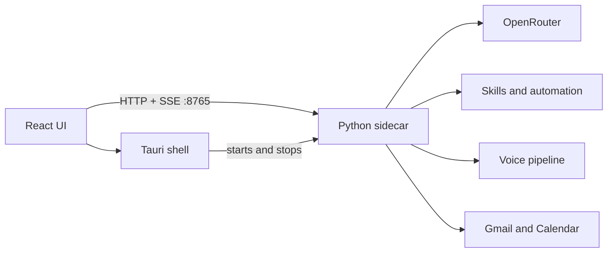

# Tesseract

A desktop assistant that works on your computer. You describe a task in the workspace, the model you chose through OpenRouter decides which actions to take, and Tesseract runs them (files, apps, browser, desktop apps, Office documents, Gmail and Google Calendar) while showing each step.


<sub>Screenshots are of the real app. The model replies in them come from the local OpenRouter mock in `sidecar/tests/e2e/mock_openrouter.py`, so they are simulated. The folder listing is a real tool run.</sub>

## Architecture



- `src/` is the React and TypeScript interface.
- `src-tauri/` is the native shell: tray, global shortcut, settings file, sidecar lifecycle.
- `sidecar/` is FastAPI: chat with tool calling, skills, voice, automation and Google OAuth.

A chat turn streams server-sent events from `/chat/stream`: text (`content`), tool progress (`tool` with `running`, `done` or `error`, plus a screenshot preview when a tool returns one) and errors. The UI shows tool progress as an activity log under each answer, and **Stop** cancels the request.

Chats are saved in SQLite at `~/.tesseract/tesseract.db` and listed in the sidebar, where you can search, rename and delete them. Each chat remembers its own model.

## Setup

### Requirements

- Node.js 18 or later
- Rust stable
- Python 3.11 or later, with `uv` or `pip`
- Windows: WebView2 (ships with Windows 11)

### 1. Install

```powershell
npm install

cd sidecar
uv venv
uv pip install -e ".[google,automation]"
.\.venv\Scripts\python.exe -m playwright install chromium
cd ..
```

### 2. Run the desktop app

```powershell
npm run tauri dev
```

The app starts the sidecar itself, using `sidecar/.venv` when it exists. If something already answers on port 8765 (for example a sidecar you started by hand), it uses that instead. Closing the window keeps Tesseract in the tray; **Ctrl+Alt+P** shows or hides it from anywhere.

### 3. Add your OpenRouter key

Open **Settings > Models & accounts**, paste a key from [openrouter.ai/keys](https://openrouter.ai/keys) and save. **Settings > About** then shows which capabilities are ready on this computer. **Settings > Appearance** switches between Light, Dark and System themes.


### Run the UI in a browser

Useful for UI work. Start the sidecar, then Vite:

```powershell
cd sidecar; $env:PYTHONPATH = "$PWD"; .\.venv\Scripts\python.exe main.py
npm run dev   # http://localhost:1420
```

Settings, chat and voice fall back to plain HTTP calls when Tauri is not present. Startup-at-sign-in only appears inside the desktop app.

## Connecting Google (Gmail and Calendar)

1. In Google Cloud Console, create an OAuth client of type **Web application**.
2. Add `http://localhost:8765/oauth/callback` as an authorized redirect URI, and enable the Gmail API and Google Calendar API.
3. In **Settings > Google account**, paste the client ID and secret and choose **Connect Google account**. Sign-in opens in your browser; Settings updates when it finishes.

Tokens are stored encrypted (AES-256-GCM) in `~/.tesseract/tokens/`. **Disconnect and revoke access** revokes the token with Google and deletes the files.

## Voice

Voice is optional and needs extra packages:

```powershell
cd sidecar
uv pip install -e ".[voice]"
```

`whisper-cpp-python` needs a C++ build toolchain on Windows. The wake word needs a free access key from [console.picovoice.ai](https://console.picovoice.ai). Turn on **Settings > Voice**, then use **Listen for wake word** or **Dictate** in the workspace toolbar. If the packages are missing, the toolbar shows **Set up voice** and the rest of the app works normally.

## Automation

Automation is off by default. Turn it on in **Settings > Automation** to let the model:

- drive a separate Chromium window (Playwright), hidden or visible
- read and operate desktop apps through Windows UI Automation. When an app does not expose a control, Tesseract falls back to OCR (needs [Tesseract OCR](https://github.com/tesseract-ocr/tesseract) and the OCR setting). If both fail, it tells you what to do instead.
- read and edit Word, Excel and PowerPoint files, optionally through installed Office (COM)

File access, for both the filesystem skill and Office, is limited to the sidecar's working directory.

## Development

```powershell
# Python tests (unit + HTTP integration, mocked OpenRouter)
cd sidecar; $env:PYTHONPATH = "$PWD"; .\.venv\Scripts\python.exe -m unittest discover -s tests

# End-to-end: built UI -> real sidecar -> mock OpenRouter, in Chromium
npm run build
cd sidecar; $env:TESSERACT_E2E = "1"; .\.venv\Scripts\python.exe -m unittest tests.e2e.test_workspace_e2e

# Rust
cargo clippy --manifest-path src-tauri/Cargo.toml --all-targets
cargo test --manifest-path src-tauri/Cargo.toml --lib

# Frontend type check and build
npm run build
```

The E2E test needs ports 1420, 8765 and 8799 free. To work on the UI without spending OpenRouter credits, run the mock (`python -m tests.e2e.mock_openrouter`) and start the sidecar with `OPENROUTER_BASE_URL=http://127.0.0.1:8799/v1`.

### API reference

With the sidecar running, FastAPI serves interactive API docs at <http://127.0.0.1:8765/docs> and the schema at `/openapi.json`.

## Packaging

```powershell
.\sidecar\build.ps1   # PyInstaller; names the binary with the Rust target triple Tauri expects
npm run tauri build
```

Installers are written to `src-tauri/target/release/bundle/`. CI (`.github/workflows/ci.yml`) runs the tests on every push and builds unsigned Windows and macOS bundles on `main`. Code signing and the Tauri updater need certificates and an update host, which are not set up yet.

## Configuration

Settings live in `~/.tesseract/settings.json` and are shared by the app and the sidecar. The file holds API keys in plain text. See the in-app Privacy page for what is sent where.

## Project map

```text
Tesseract/
├── src/                 React interface (components, hooks, services)
├── src-tauri/           Tauri shell, settings commands, sidecar lifecycle
├── sidecar/
│   ├── llm/             OpenRouter client and tool-calling loop
│   ├── auth/            Google OAuth
│   ├── automation/      Web, desktop and Office engines
│   ├── skills/          Tools the model can call (auto-discovered)
│   ├── voice/           Wake word, STT, TTS, pipeline
│   └── tests/           Unit, integration and E2E tests
└── assets/screenshots/  Images used in this README
```

## License

MIT is intended. A LICENSE file has not been added yet.
