A desktop assistant that works on your computer. You describe a task in the workspace, the model you chose (ChatGPT plan, Claude or OpenRouter) decides which actions to take, and Tesseract runs them (files, apps, browser, desktop apps, Office documents, Gmail and Google Calendar) while showing each step.




<sub>Illustration of a chat turn, not a recording of the app.</sub>

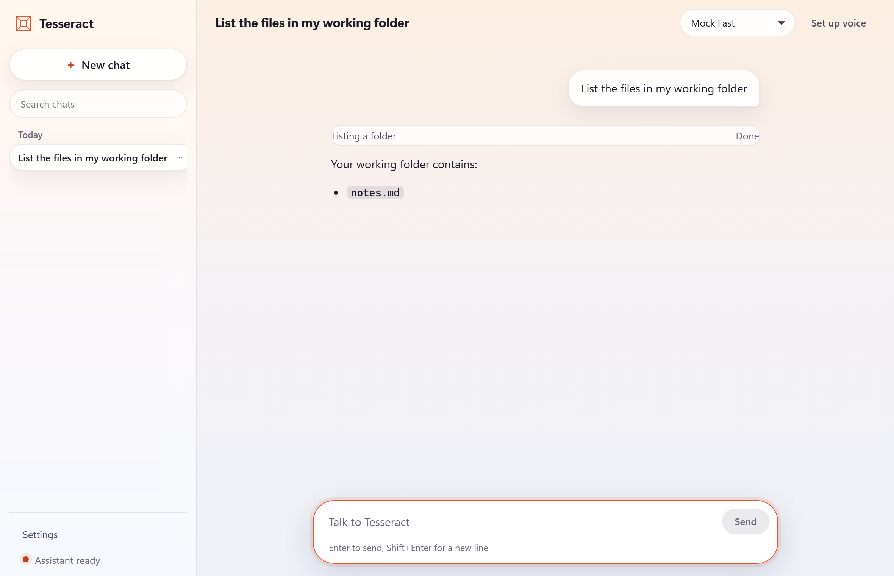

<sub>Screenshots are of the real app. The model replies in them come from the local OpenRouter mock in `sidecar/tests/e2e/mock_openrouter.py`, so they are simulated. The folder listing is a real tool run.</sub>


## Architecture

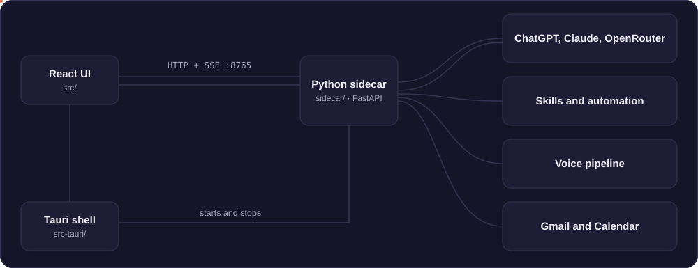

- `src/` is the React and TypeScript interface.
- `src-tauri/` is the native shell: tray, global shortcut, settings file, sidecar lifecycle.
- `sidecar/` is FastAPI: chat with tool calling, skills, voice, automation, model accounts and Google OAuth.

A chat turn streams server-sent events from `/chat/stream`: text (`content`), tool progress (`tool` with `running`, `done` or `error`, plus a screenshot preview when a tool returns one) and errors. The UI shows tool progress as an activity log under each answer, and **Stop** cancels the request.

Chats are saved in SQLite at `~/.tesseract/tesseract.db` and listed in the sidebar, where you can search, rename and delete them. Each chat remembers its own model.


## Setup


### Requirements

- Node.js 18 or later
- Rust stable
- Python 3.11 or later, with `uv` or `pip`
- Windows: WebView2 (ships with Windows 11)

### 1. Install

```powershell
npm install

cd sidecar
uv venv
uv pip install -e ".[google,automation]"
.\.venv\Scripts\python.exe -m playwright install chromium
cd ..
```

### 2. Run the desktop app

```powershell
npm run tauri dev
```

The app starts the sidecar itself, using `sidecar/.venv` when it exists. If something already answers on port 8765 (for example a sidecar you started by hand), it uses that instead. Closing the window keeps Tesseract in the tray; **Ctrl+Alt+P** shows or hides it from anywhere.

### 3. Connect a model

Open **Settings > Models & accounts** and connect at least one account (see [Models & accounts](#models--accounts)). **Settings > About** then shows which capabilities are ready on this computer. **Settings > Appearance** switches between Light, Dark and System themes.

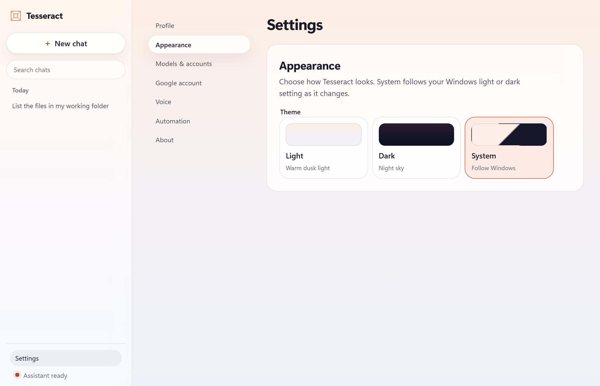

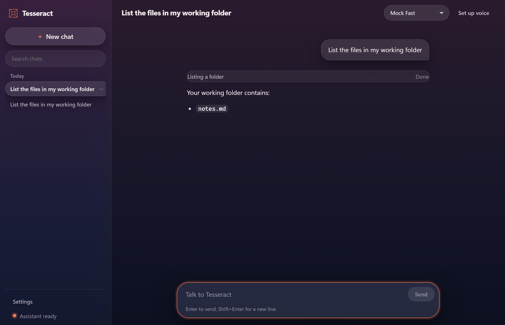

### Run the UI in a browser

Useful for UI work. Start the sidecar, then Vite:

```powershell
cd sidecar; $env:PYTHONPATH = "$PWD"; .\.venv\Scripts\python.exe main.py
npm run dev   # http://localhost:1420
```

Settings, chat and voice fall back to plain HTTP calls when Tauri is not present. Startup-at-sign-in only appears inside the desktop app.


## Models & accounts

**Settings > Models & accounts** has one card per provider. The workspace model picker lists only the providers you have connected, grouped by provider, and each chat remembers its own model. With nothing connected it shows **Connect a model**.

- **ChatGPT:** **Continue with ChatGPT** signs you in through your browser (OpenAI's sign-in for local apps) and uses your ChatGPT plan, so there is no API key and no per-token bill. One ChatGPT account at a time. **Sign out** removes the tokens here; **Use a different account** starts a fresh sign-in.
- **Claude (Anthropic):** paste an API key from [console.anthropic.com](https://console.anthropic.com/settings/keys).
- **OpenRouter:** paste a key from [openrouter.ai/keys](https://openrouter.ai/keys).

Saved keys show only their last four characters, with **Replace key** and **Remove**.


Secrets (API keys, the ChatGPT tokens and the Google client secret) live in an encrypted vault, `~/.tesseract/secrets.enc`. Its AES key sits in the OS credential store (Windows Credential Manager, macOS Keychain). A key still in plain text in `settings.json` from an older version is moved into the vault on first start and blanked in the file; if it can't be moved, it stays where it was until the credential store works. Saving a key while the credential store is unavailable fails with a message instead of writing it in plain text.


## Connecting Google (Gmail and Calendar)

1. In Google Cloud Console, create an OAuth client of type **Web application**.
2. Add `http://localhost:8765/oauth/callback` as an authorized redirect URI, and enable the Gmail API and Google Calendar API.
3. In **Settings > Google account**, paste the client ID and secret and choose **Connect Google account**. Sign-in opens in your browser; Settings updates when it finishes.

Tokens are stored in the encrypted vault (see [Models & accounts](#models--accounts)); token files from older versions are moved into it on first start. **Disconnect and revoke access** revokes the token with Google and deletes the stored tokens.


## Voice

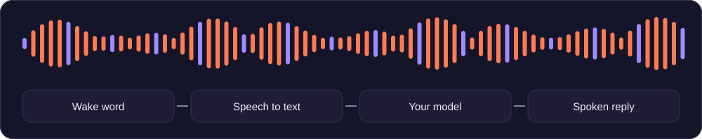

Voice is optional and needs extra packages:

```powershell
cd sidecar
uv pip install -e ".[voice]"
```

`whisper-cpp-python` needs a C++ build toolchain on Windows. The wake word needs a free access key from [console.picovoice.ai](https://console.picovoice.ai). Turn on **Settings > Voice**, then use **Listen for wake word** or **Dictate** in the workspace toolbar. If the packages are missing, the toolbar shows **Set up voice** and the rest of the app works normally.


## Automation


Automation is off by default. Turn it on in **Settings > Automation** to give the model these tools. It still asks before each change (see [Approvals](#approvals)):

- drive a separate Chromium window (Playwright), hidden or visible
- find any installed Windows app by name and open it, including Store apps
- read and operate desktop apps through Windows UI Automation: click, type, press shortcuts, scroll and wait. Before each action it checks that the intended window is in front, and stops if it can't bring it back. When an app does not expose a control, Tesseract falls back to OCR (needs [Tesseract OCR](https://github.com/tesseract-ocr/tesseract) and the OCR setting). If both fail, it tells you what to do instead.
- work inside open Excel, Word and PowerPoint documents through installed Office: read and write cells, build real PivotTables, edit text and slides. It attaches to what you have open, keeps your unsaved changes, never closes anything, and saves only when it calls the save tool. Macros in files it opens stay off.
- read and edit Word, Excel and PowerPoint files without opening Office

**Let the model see screenshots** in Settings > Automation is off by default. When it's on, Tesseract asks before each screenshot unless you chose **Always allow this**, and anything visible in it goes to your model provider. The model must support images.

Which files these tools reach depends on **Settings > Permissions** (see [Approvals](#approvals)).


## Approvals

Tesseract reads freely (files, email, calendar, web pages, windows) but asks before it changes anything: writing a file, sending an email, creating or deleting an event, opening an app, clicking or typing. The chat shows a card with what it wants to do and three buttons: **Allow**, **Always allow this** and **Don't allow**. Sending an email and deleting an event are marked **Can't be undone**.


- You can also answer in your own words in the message box ("yes go ahead", "nah, wait"). Anything unclear counts as not allowed, and the model gets your words.
- A card nobody answers within 10 minutes counts as not allowed. Stopping the reply cancels it.
- **Settings > Permissions** sets how far the file, Office and open tools reach: **Entire device**, **Your user folders**, **Desktop, Documents and Downloads** or **Working folder only**. Tools can never use `~/.tesseract`, at any level. Clicking and typing in other apps is not limited by this setting, because those apps can open whatever your account can.
- The same page lists everything you chose **Always allow this** for, with **Revoke** buttons. The list is stored in `~/.tesseract/permissions.json`.
- Opening apps, files and links does not need automation turned on, but always asks first (unless always allowed).
- Voice can only read for now: a spoken request that needs a change is refused, and the model asks you to approve it in the chat window. Spoken approvals come with the voice update.


## Development

```powershell
# Python tests (unit + HTTP integration, mocked OpenRouter)
cd sidecar; $env:PYTHONPATH = "$PWD"; .\.venv\Scripts\python.exe -m unittest discover -s tests

# End-to-end: built UI -> real sidecar -> mock OpenRouter, in Chromium
npm run build
cd sidecar; $env:TESSERACT_E2E = "1"; .\.venv\Scripts\python.exe -m unittest tests.e2e.test_workspace_e2e

# Rust
cargo clippy --manifest-path src-tauri/Cargo.toml --all-targets
cargo test --manifest-path src-tauri/Cargo.toml --lib

# Frontend type check and build
npm run build
```

The E2E test needs ports 1420, 18765 and 18799 free. To work on the UI without spending OpenRouter credits, run the mock (`python -m tests.e2e.mock_openrouter`) and start the sidecar with `OPENROUTER_BASE_URL=http://127.0.0.1:8799/v1`.

### API reference

With the sidecar running, FastAPI serves interactive API docs at <http://127.0.0.1:8765/docs> and the schema at `/openapi.json`.


## Packaging

```powershell
.\sidecar\build.ps1   # PyInstaller; names the binary with the Rust target triple Tauri expects
npm run tauri build
```

Installers are written to `src-tauri/target/release/bundle/`. CI (`.github/workflows/ci.yml`) runs the tests on every push and builds unsigned Windows and macOS bundles on `main`. Code signing and the Tauri updater need certificates and an update host, which are not set up yet.


## Configuration

Settings live in `~/.tesseract/settings.json` and are shared by the app and the sidecar. Secrets are not kept there (see [Models & accounts](#models--accounts)). See the in-app Privacy page for what is sent where.


## Project map

```text
Tesseract/
├── src/                 React interface (components, hooks, services)
├── src-tauri/           Tauri shell, settings commands, sidecar lifecycle
├── sidecar/
│   ├── llm/             Provider clients (ChatGPT, Claude, OpenRouter) and tool-calling loop
│   ├── auth/            Google and ChatGPT sign-in
│   ├── automation/      Web, desktop and Office engines
│   ├── skills/          Tools the model can call (auto-discovered)
│   ├── voice/           Wake word, STT, TTS, pipeline
│   └── tests/           Unit, integration and E2E tests
├── assets/readme/       Animated SVGs used in this README
└── assets/screenshots/  Screenshots used in this README
```


## License

MIT is intended. A LICENSE file has not been added yet.
